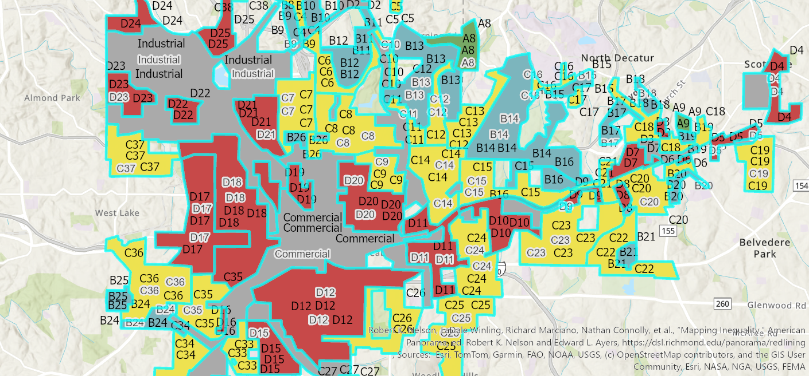

# [Jamie Jacklin] 
[I am a perpetual student and have been studying at R.C.C. for 25 years off and on.  I started a new job at Riverside County's Transportation Department and attended the ESRI Conference in San Diego in the summer of 2026, and I became interested in G.I.S.] --- 
## [Enrich_redlining_Jacklin: Map of Home Owners' Loan Corporation Grades"] 
 
*Interactive version, live as of [Month Year]: [paste public link]* 
*(Delete this line if your map is not a web app.)* 
**Question:** [What was the effect of redlining in Atlanta's past on 2024 socioeconomic data?] 
**Data:** [Redlining_Atlanta, ESRI, 2023, ArcGIS Pro.] 
**Method:** [Downloaded "Redlining_Atlanta from ArcGIS Online in the geoprocessing pane.] 
**A design choice I made and why:** [One specific decision. Classification 
method, color scheme, projection, what you labeled, what you left out.] 
**A limitation of this map:** [What this map cannot tell the reader. 
Be honest. Every map has one.] --- --6-- 
## [Lab2_Layout_Jacklin] 
 
**Question:** [Which ZIP Code Tabulation Area has the highest COVID-19 Case Count?] 
**Data:** [COVID19_ZCTA, ESRI, ArcGIS Online.]
**Method:** [Added a streaming layer from ArcGIS Online to my basemap.] 
**A design choice I made and why:** [Adding the legend was a deliberate choice.] 
**A limitation of this map:** [This map only highlights the boroughs from New York City]--- 
## Data sources - [Dataset name, publisher, year, URL] - [Dataset name, publisher, year, URL] 
## Where this is going 
[One paragraph: what you plan to add to this portfolio by the end 
of the term, and what you want it to say about you.]
